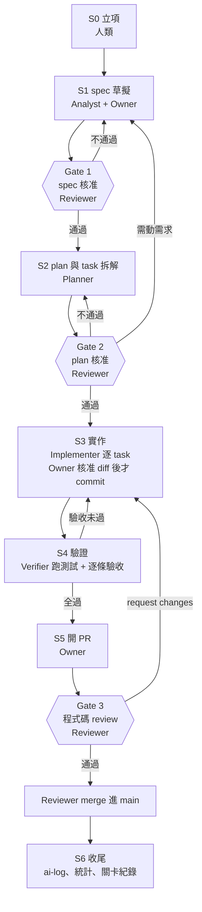

# AI-Agent 組 開發流程（Spec-Driven Development）

**v1.0 · 2026-11-09**

本文件可滾動修改，改法見第 12 節。

---

## 0. 這份文件是什麼

`project-common/docs/VISION.md` 第 10 節把 workflow 留給各組自訂：「各組可自行撰寫 workflow 來跑，做法屬各組方法論的一部分，本文件不規定。」這份文件就是本組（AI-Agent 組）的那套做法。

本組的方法論一句話講完：**spec 先經人類定案，agent 依 spec 產出，人類在三道關卡簽核後才准往下走。**

| 本文件規範 | 本文件不規範 |
| --- | --- |
| 本組怎麼工作：角色、產物、循環、關卡、紀錄 | 要做什麼遊戲（在 `VISION.md`） |
| agent 的權限邊界與人類的責任歸屬 | 具體機制與數值（在各 feature 的 spec） |
| 證據怎麼留在 git 裡 | 其他兩組怎麼做（完成前不互讀） |

本文件**不覆寫** `VISION.md`。兩者衝突時一律以 `VISION.md` 為準，並把衝突記進第 12 節的修訂紀錄。

---

## 1. 原則

這五條是後面所有規則的依據。規則有漏洞時，回頭看這五條。

1. **人類負全責。** AI 產出的錯誤是我們的錯誤。「AI 寫的」不是解釋，更不是免責。
2. **spec 是唯一真相來源。** 程式碼和 spec 不一致時，不是改碼對齊就算了 —— 先決定哪一邊錯，要改 spec 就回 Gate 1。
3. **agent 不自行擴張範圍。** `VISION.md` 與 spec 沒寫的需求，agent 只能「提出並標記」，不能直接做。要不要納入是人類的決定。
4. **每一步都要留得下證據。** 對話關掉以後，repo 要看得出來發生過什麼、誰決定了什麼、為什麼。
5. **關卡不是形式。** 沒讀過就按核准，等於沒有關卡，而且會讓第 1 條變成空話。

---

## 2. 角色

### 2.1 人類（本組 2 人）

每個 feature 指定一位 **Owner** 和一位 **Reviewer**，下一個 feature 互換。寫在該 feature spec 的 frontmatter 裡。

| 角色 | 負責 |
| --- | --- |
| **Owner** | 立項、寫與修 spec、驅動 agent、逐筆核准 diff、開 PR、更新 AI 使用紀錄 |
| **Reviewer** | 簽 Gate 1、Gate 2，執行 Gate 3 的 PR review，merge 進 `main` |
| **兩人共同** | 交付物的最終責任、每週對一次 AI 使用紀錄的統計、流程本身的修訂 |

**不可自審**：自己當 Owner 的 PR 不自己 approve、不自己 merge。例外見 11.2。

### 2.2 Agent（四個職能）

這裡講的是**職能**，不是四個獨立的人格。實作上可以是同一個 session 的不同階段，也可以是分開的 subagent —— 用哪一種要在 AI 使用紀錄的「啟用的自動化」欄揭露（`VISION.md` 第 10 節要求）。

| 職能 | 在哪一步 | 輸入 | 輸出 | 禁止 |
| --- | --- | --- | --- | --- |
| **Analyst** 需求釐清 | S1 | `VISION.md`、客戶訪談紀錄、`docs/specs/SYSTEM.md` | feature spec 草稿 + 開放問題清單 | 自己回答開放問題；自己決定數值 |
| **Planner** 方案規劃 | S2 | 已核准的 spec | plan（含 task 拆解） | 修改 spec；引入 spec 沒有的需求 |
| **Implementer** 實作 | S3 | 已核准的 plan | 工作區變更 + 測試 | 超出 tasks 範圍；動 `project.godot` 的共用欄位 |
| **Verifier** 驗證 | S4 | spec 的驗收條件、已完成的程式碼 | 驗收報告（逐條過/不過） | 為了讓測試過而改程式碼（要退回 Implementer） |

**Verifier 不能同時是 Implementer。** 同一個 session 連續跑完實作和驗證時，驗證必須重新讀 spec 的驗收條件，不能只看自己剛寫的碼。這一條是給 agent 的指示，也是 Gate 3 的檢查項。

### 2.3 Agent 絕對不做的事

這些是硬規則，寫進給 agent 的指示裡，違反就是流程事故（記進 `gates.md`，是報告素材）。

- 不修改 `project-common` 的任何檔案，特別是 `VISION.md`。要改須三組同意，走那邊的流程。
- 不修改已核准（`status: approved`）的 spec 或 plan。要改走 11.1。
- **未經人類核准 diff，不得 `git commit`。**
- 任何情況下不得 `push` 到 `main`、不得 merge PR、不得 `force push`、不得改寫 git 歷史、不得 `git reset --hard` 丟掉未 commit 的人類改動。
- 不讀取其他兩組的 repo（`VISION.md` 第 11 節第 6 條）。
- 不把機密資料寫進 prompt 或 repo（第 8 節）。
- 不自行安裝 Godot 以外的依賴、不升級引擎版本（`VISION.md` 第 10 節釘 4.7.2 stable）。

---

## 3. 產物與目錄

```
group-AI/
├── project.godot                     # 共用骨架，依 VISION 第 10 節，不自行更動共用欄位
├── docs/
│   ├── WORKFLOW.md                   # 本文件
│   ├── specs/
│   │   ├── SYSTEM.md                 # 系統層 spec：邊界、共用概念、各 feature 的關係
│   │   └── features/
│   │       ├── 001-<slug>.md         # feature 子 spec
│   │       └── 002-<slug>.md
│   ├── plans/
│   │   └── 001-<slug>-plan.md        # 對應 feature 的技術方案 + task 拆解
│   ├── agent-runs/
│   │   └── 001-<slug>/
│   │       ├── prompts.md            # 給 agent 的指示原文
│   │       ├── transcript.md         # 裁切後的決策摘錄
│   │       └── gates.md              # 三道關卡的核准紀錄
│   ├── meeting/                      # 會議紀錄、客戶訪談紀錄（VISION 第 9 節第 4 點）
│   ├── ai-log/                       # AI 使用紀錄（project-common 範本）
│   └── templates/                    # 本流程的範本，複製後填寫
└── (遊戲程式碼)
```

| 產物 | 誰產生 | 何時 | 誰核准 |
| --- | --- | --- | --- |
| `specs/SYSTEM.md` | Agent 草擬、兩人共同修 | 第一個 feature 之前 | 兩人都要同意 |
| `specs/features/NNN-*.md` | Analyst 草擬、Owner 修 | S1 | Reviewer（Gate 1） |
| `plans/NNN-*-plan.md` | Planner | S2 | Reviewer（Gate 2） |
| 程式碼與測試 | Implementer | S3 | Owner 核准 diff、Reviewer 過 PR（Gate 3） |
| `agent-runs/NNN-*/` | Owner 整理 | S1–S6 全程 | 無（但 Gate 3 會檢查有沒有寫） |
| `ai-log/` | Owner 當天填 | 全程 | 兩人每週對統計 |

編號 `NNN` 從 `001` 起，依立項順序遞增，不重用。`<slug>` 用英文小寫連字號，例如 `001-colonist-state`。

`000` 保留給 repo 的 bootstrap 工作（流程文件本身的紀錄，見 `docs/agent-runs/000-workflow-v1/`），不是 feature。

---

## 4. 一個 feature 的循環



### S0 立項（人類，不用 agent）

Owner 在 `docs/specs/features/` 建檔，複製 `docs/templates/SPEC_TEMPLATE.md`，填好編號、slug、Owner、Reviewer、以及「這個 feature 要支撐 `VISION.md` 的哪一節」。

開 branch：`git switch -c spec/NNN-<slug>`。

**為什麼人類做**：要做哪個 feature、先做哪個，是人類的排序決定。讓 agent 選題等於讓它定範圍。

### S1 spec 草擬（Analyst + Owner）

Owner 把 `VISION.md`、`SYSTEM.md`、相關訪談紀錄給 agent，要它產出 spec 草稿。

agent 必須做到：
- 每一條需求標明可追溯到 `VISION.md` 的哪一節，或哪一次客戶訪談。追不到的，標 `INV` 放進「AI 提出、待人類決定」區塊，不直接寫進需求。
- 驗收條件寫成可驗證的句子。「手感要好」不算，「危機波次在 day N 觸發時，玩家可見倒數提示至少 5 秒」算。
- 開放問題列出來，不要自己填答案。數值一律是開放問題。

Owner 逐條看過、改寫、刪掉不要的，決定 `INV` 項目的去留（去留都要有理由，寫進 ai-log）。開放問題需要客戶回答的，去訪談（紀錄進 `docs/meeting/`）。

**→ Gate 1**

### S2 plan 與 task 拆解（Planner）

輸入只有已核准的 spec。agent 產出 `docs/plans/NNN-<slug>-plan.md`，包含技術方案、要動哪些檔案、以及 task 拆解。

task 的要求：
- 一個 task 能在一個 agent session 內做完，並且有明確的「做完了」判準。
- 每個 task 對應到 spec 的哪一條驗收條件。
- 用到的 Godot API 逐個標 `已驗證（4.7 文件連結）` 或 `unverified`。`unverified` 的要先去 `docs.godotengine.org/en/4.7/` 查清楚才能進 Gate 2（`VISION.md` 第 10 節「引擎 API 驗證」）。

**→ Gate 2**

### S3 實作（Implementer，逐 task）

一個 task 一輪，每輪固定三步：

1. agent 做完一個 task，停下來，展示 `git diff` 與它改了什麼、為什麼。
2. **Owner 讀 diff 並核准。** 不核准就說明要改哪裡，重跑這一輪。
3. 核准後才由 agent 執行 `git commit`（commit message 依 `project-common/docs/COMMIT_CONVENTION.md`，AI 主要產出的加 `Co-Authored-By`），push 到 feature branch。

**一個核准 = 一個 commit。** 不要累積三個 task 一次 commit —— 那會讓「哪一筆經過 review」在 git log 裡看不出來。

task 做不下去（plan 有錯、spec 有漏）時：**停下來回報，不要自己改 spec 或 plan 繞過去。** 退回 S2 或 S1。

### S4 驗證（Verifier）

- 跑測試：核心規則（波次推進、狀態轉換、結算計分這類純邏輯）寫 GUT 單元測試並跑過。手感、UI、視覺走 spec 裡的手動驗收清單，由人類實際操作確認。
- 對 spec 的驗收條件**逐條**回報過或不過，不過的要寫實際行為。
- 驗收報告貼進 PR，並摘要進 `agent-runs/NNN-*/transcript.md`。

有條件不過就退回 S3。**不准改驗收條件來讓它過** —— 要改驗收條件得回 Gate 1。

### S5 開 PR（Owner）

PR 標題用 feature 名，內文至少包含：spec 與 plan 的連結、驗收條件逐條結果、測試輸出、`agent-runs/` 的連結、以及這輪 ai-log 新增了哪幾筆。

**→ Gate 3**

### S6 收尾（Owner）

merge 之後：
- 補齊 `ai-log/`（當天就要填，不要累積到交件前補）。
- `agent-runs/NNN-*/gates.md` 補上三道關卡的最終狀態與退回次數。
- spec frontmatter 的 `status` 改 `done`。
- 刪掉 feature branch。

---

## 5. 三道關卡

共通規則：

- **核准前必須真的讀過產物。** Reviewer 在核准紀錄裡寫一句「我看了什麼、注意到什麼」，不是只蓋章。
- **核准落在 git 裡。** Gate 1、Gate 2 簽在文件的 frontmatter 並 commit；Gate 3 走 GitHub PR review。這樣助教看 git log 和 PR 就能看到關卡。
- **沒簽，agent 不准往下。** 這是作業明文要求的那條線。
- **不通過時要講清楚退回哪一步**（退 S3 / 退 S2 / 退 S1），不要只說「再想想」。

### Gate 1 — spec 核准

**誰簽**：Reviewer。**簽在哪**：spec frontmatter（`status: approved` / `approved-by` / `approved-at`），commit 用 `docs(req)`。

判準（全部要過）：

- [ ] 每條需求都可追溯到 `VISION.md` 的某一節或某次客戶訪談
- [ ] 驗收條件每條都可驗證，不是主觀形容
- [ ] 明確列出這個 feature **不做**什麼（避免 S3 時範圍漂移）
- [ ] agent 標的 `INV` 項目都已經由人類決定去留，理由進 ai-log
- [ ] 沒有違反 `VISION.md` 第 6 節的範圍外清單
- [ ] 開放問題清零，或明確標「延後到 feature NNN」
- [ ] 沒有出現具體到越界的數值（數值屬各組設計產出，但不該在需求層就被 AI 填滿）

### Gate 2 — plan 核准

**誰簽**：Reviewer。**簽在哪**：plan frontmatter，commit 用 `docs(req)`。

判準：

- [ ] plan 沒有引入 spec 沒有的需求（有的話退回 Gate 1 決定要不要納入）
- [ ] 每個 task 有驗收方式，且能在一個 session 內做完
- [ ] 每個 task 對應到 spec 的哪一條驗收條件，沒有孤兒 task
- [ ] 用到的 Godot API 全部標了驗證狀態，沒有殘留 `unverified`
- [ ] 會動到 `project.godot` 共用欄位的改動單獨標出（原則上不准動，`VISION.md` 第 10 節）
- [ ] 測試策略寫清楚：哪些寫 GUT、哪些手動驗收

### Gate 3 — 程式碼 review

**誰簽**：Reviewer（不是 Owner）。**簽在哪**：GitHub PR 的 approve。

判準：

- [ ] diff 只動 tasks 涵蓋的範圍，沒有順手改的東西
- [ ] spec 的驗收條件逐條過，證據在 PR 裡
- [ ] 測試跑過，輸出貼在 PR
- [ ] 每個 commit 的 message 合 `COMMIT_CONVENTION.md`，AI 主要產出的有 `Co-Authored-By`
- [ ] 每個 commit 都對應一次人類核准（commit 數量和核准次數對得上）
- [ ] `ai-log/` 已更新，`API` 與 `INV` 分開標
- [ ] `agent-runs/NNN-*/` 三個檔案都有內容
- [ ] 沒有機密資料進 repo（第 8 節）
- [ ] 沒有改到 `project-common` 的內容

---

## 6. Git 規範

- **branch**：`spec/NNN-<slug>`，一個 feature 一條、一個 PR。拋棄式實驗用 `spike/<slug>`，見 11.4。
- **`main` 受保護**：不直接 push，一律經 PR，且須一個 approve。GitHub 上設 ruleset；設不起來就以約定執行，並在第 12 節記下這是人工把關的例外。
- **commit message**：依 `project-common/docs/COMMIT_CONVENTION.md`，不另立一套。
- **一個 task 一個 commit**，對應一次人類核准。
- **流程文件自己的變動**用 `docs(repo)`。
- **不改寫歷史**：不 `force push`、不 rebase 已 push 的 branch。歷史是報告的證據，整理過的歷史就不是證據了。

### 本組的 commit scope 補充

`COMMIT_CONVENTION.md` 規定程式碼 scope 由各組自訂並記在自己 repo。本組的：

| scope | 範圍 |
| --- | --- |
| `spec` | 本組的 spec 文件（`docs/specs/`） |
| `plan` | 本組的 plan 文件（`docs/plans/`） |
| `agent-run` | agent 紀錄（`docs/agent-runs/`） |
| `sim` | 時間推進、每日循環 |
| `colonist` | 殖民者狀態與行為 |
| `crisis` | 危機波次與調壓 |
| `construct` | 建造與自動化 |
| `ui` | 介面與回饋 |
| `score` | 單場結算 |

程式碼 scope 待 `SYSTEM.md` 定案後可能調整，調整時一起更新這張表（`docs(repo)`）。

---

## 7. Agent 紀錄怎麼存

作業要求「把 spec、agent 的 plan 與 transcript、以及你們的 review 留在 git repo 裡」。spec 與 plan 本來就是檔案；transcript 需要規則，否則會變成沒人看得完的垃圾場。

**不存完整對話 JSONL。** 理由：量大、雜訊多（工具輸出、重複貼的檔案內容），而且容易把不該進 repo 的東西一起帶進來。原始 JSONL 留在本機（Claude Code 的 `~/.claude/projects/` 底下）直到交件，不進 repo。

每個 feature 一個 `docs/agent-runs/NNN-<slug>/`：

| 檔案 | 放什麼 |
| --- | --- |
| `prompts.md` | 每次給 agent 的指示**原文照貼**（去掉機密資料），附日期與對應步驟 |
| `transcript.md` | 裁切後的決策摘錄 |
| `gates.md` | 三道關卡的核准紀錄、判準過沒過、退回次數與原因 |

`transcript.md` 的裁切原則 —— **留下**：

- 決定與理由（尤其是推翻先前決定的）
- **AI 提議但被拒絕的內容，以及拒絕的理由**（報告最有價值的部分）
- 引擎 API 的驗證過程與結果
- agent 自己發現 plan 或 spec 有問題、停下來回報的段落
- session id 與日期（Claude Code 用 `/status` 查），以便回溯原始紀錄

**刪掉**：重複貼的檔案內容、工具輸出雜訊、單純的「好的我來做」。

判斷有疑慮時留著。刪掉關鍵證據比檔案太大嚴重得多。

---

## 8. 機密資料

**禁止進入 prompt、也禁止進入 repo：**

- 真人個資：組員與客戶的真名以外的識別資料 —— 學號、電話、email、私人帳號
- 任何帳號密碼、API key、token、課程系統或學校系統的登入資訊
- 其他兩組的 repo 內容與未公開產出（`VISION.md` 第 11 節第 6 條）
- 老師與助教未公開的文件、評分資料

客戶訪談紀錄用角色稱呼（「客戶」、「組員 A」），不寫個資。

**為什麼連 prompt 都算**：送進 AI 工具的內容等同送到外部服務，可能被留存或快取，事後刪除不保證消失。

**不小心貼進去了怎麼辦**：

1. 立刻在 `ai-log/` 記一筆（這本身是誠實度的證據，不是要隱藏的事）
2. 那一段對話不進 repo
3. 如果是憑證，立刻更換
4. 如果已經 commit，在第 12 節記錄並處理掉內容（歷史不改寫，但要說明）

---

## 9. 與 AI 使用紀錄的接點

AI 使用紀錄依 `project-common/docs/AI_LOG_TEMPLATE.md`，複製到 `docs/ai-log/`。這裡只定「流程的哪一步會長出哪種紀錄」：

| 步驟 | 典型紀錄 | 標記 |
| --- | --- | --- |
| S1 spec | agent 加了 `VISION.md` 沒有的需求或機制 | `INV` |
| S1 spec | agent 產出的內容其實是在重現《缺氧》的設計 | `INV` + `DUP` |
| S2 plan | agent 用到 Godot 4.2/4.5 的舊 API | `API` |
| S3 實作 | 同上，或產出不存在的 API | `API` |
| S4 驗證 | agent 想改驗收條件讓測試過 | `INV`（記為範圍漂移） |

規則：

- **每個 feature 收尾（S6）前必須更新 ai-log，否則 Gate 3 不過。**
- 工時記實際花的時間，**包含 review 與修正 AI 產出的時間**，不是只算等回應的時間。
- `API` 與 `INV` 一定分開統計 —— 前者是 Godot 4.7 晚於模型知識截止造成的雜訊，後者才是三組要比較的現象。

---

## 10. 範本

`docs/templates/` 底下，複製後填寫：

| 範本 | 複製到 |
| --- | --- |
| `SPEC_TEMPLATE.md` | `docs/specs/features/NNN-<slug>.md` |
| `PLAN_TEMPLATE.md` | `docs/plans/NNN-<slug>-plan.md` |
| `agent-run/` 整個目錄 | `docs/agent-runs/NNN-<slug>/` |

---

## 11. 例外與回頭路

### 11.1 已核准的 spec 或 plan 要改

1. Owner 說明為什麼要改
2. 在該文件底部的 changelog 加一列：日期、改了什麼、**為什麼**
3. `status` 改回 `draft`
4. 重跑對應的關卡（改 spec 回 Gate 1，改 plan 回 Gate 2）

已 merge 的程式碼**不追溯重寫**，除非被改動的是驗收條件本身。

### 11.2 兩人其中一人不在

**關卡可以延後，不可以跳過，也不可以自審。** 真的卡住就把工作停在關卡前，不要讓 agent 往下做 —— 做完才發現方向錯，浪費的是人類 review 的時間。

真的有時程壓力而破例時，在 `gates.md` 寫明「此關卡由 Owner 自審，原因 X」。這是流程事故，不是常態，而且會進報告。

### 11.3 agent 跑飛了

branch 直接廢棄，不 merge。在 `agent-runs/NNN-*/gates.md` 記一筆廢棄原因。

**這是報告素材，不是丟臉的事** —— 「agent 在哪種指示下會失控」正是這個方法論要回答的問題。

### 11.4 Spike（拋棄式實驗）

為了試可行性的實驗不走這套流程：branch 用 `spike/<slug>`，不寫 spec、不寫 plan、**不得 merge**。

學到的東西寫回 spec，然後從 S1 重走流程。spike 的程式碼不保留。

---

## 12. 本文件的修訂

**這份文件可以改，而且預期會改。** 這點和 `VISION.md` 不同：

| | `VISION.md` | 本文件 |
| --- | --- | --- |
| 修改條件 | 三組同意，記在第 12 節 | 本組兩人同意 |
| 性質 | 三組的共同輸入 | 本組方法論的一部分 |

改法：

1. 開 PR（branch 用 `docs/workflow-vN`），另一人 approve
2. commit 用 `docs(repo)`
3. 在下方表格加一列，**寫清楚為什麼改**
4. 版本號：判準或措辭的小修 `+0.1`；流程結構變動（增減關卡、改角色分工）`+1.0`

**改了不追溯已完成的 feature。** 第 3 個 feature 才加的判準，不回頭套用到第 1、2 個。

**為什麼要留修訂紀錄**：流程怎麼演進、因為撞到什麼問題而改，本身就是這個方法論最有價值的觀察。「我們第 3 個 feature 才發現 Gate 2 擋不住 agent 自己加需求，所以加了第 2 條判準」比「我們一開始就設計了完美的流程」可信得多，也更有內容可寫。

| 版本 | 日期 | 改了什麼 | 為什麼 |
| --- | --- | --- | --- |
| v1.0 | 2026-11-09 | 初版：三道關卡、兩層 spec、人類核准 diff 後由 agent commit、agent 紀錄裁切規則 | 依 `VISION.md` 第 10 節建立本組 workflow；作業要求定義角色、產物、循環與 review gate |

---

## 13. AI 使用揭露（本文件）

| 工具 | AI 做了什麼 | 接受 | 拒絕／修正 |
| --- | --- | --- | --- |
| Claude Code（Claude Opus 5） | 讀 `project-common` 的 VISION、commit 規則與 AI 紀錄範本，提出 workflow 的決策選項，草擬本文件結構與內容 | 三道關卡的位置與判準清單、agent 四職能的權限邊界、transcript 裁切原則、修訂機制 | spec 粒度（改為兩層：系統 spec + feature 子 spec）、關卡數（3 道）、commit 權限（人類核准 diff 後由 agent commit）、組員人數與 review 分工，皆由組內決定 |
